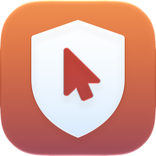
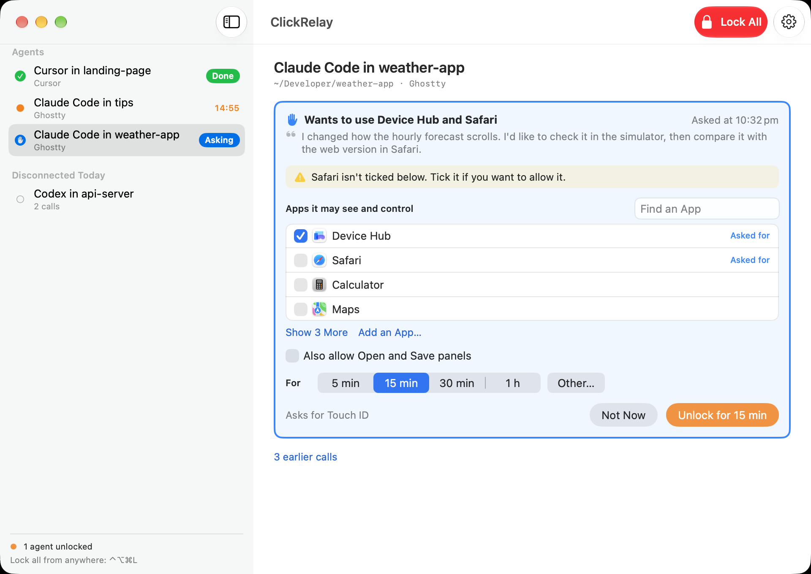
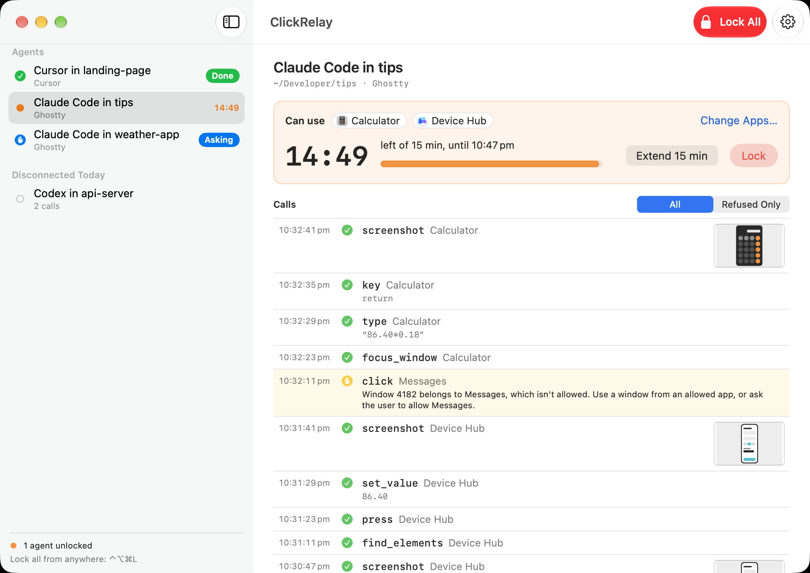
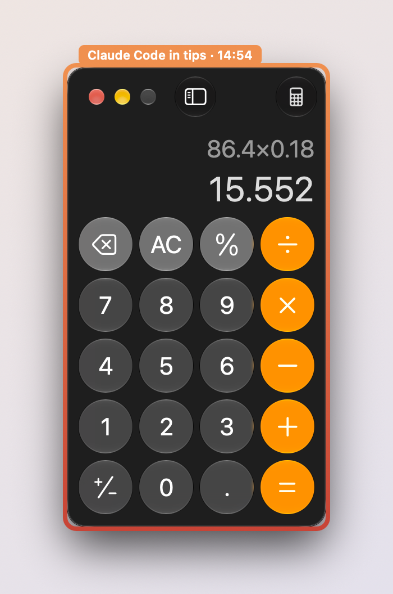
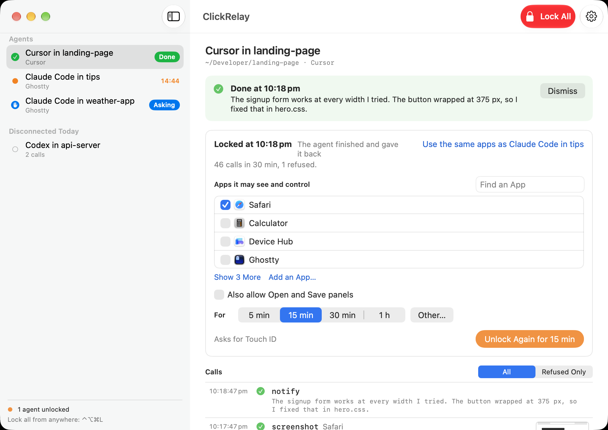

# ClickRelay

Let your coding agent use your Mac, on your terms.

ClickRelay is a macOS app that gives coding agents (Claude Code, Codex, Cursor and others) screenshots and mouse and keyboard control through a local MCP server. It only does this after you unlock it with Touch ID, only for the apps you pick, and only for as long as you choose. When the time runs out it locks itself.

More about ClickRelay at [apps.mergeable.io/clickrelay](https://apps.mergeable.io/clickrelay/).



> [!WARNING]
> ClickRelay is in beta. Expect rough edges, and changes to the tools and settings between releases. Please [open an issue](https://github.com/maxchuquimia/ClickRelay/issues) if something breaks or behaves in a way you didn't expect.

## Why

Agents are good at checking their own work in a simulator or a browser, but giving a terminal Screen Recording and Accessibility means anything running in it can see and drive your whole Mac, forever. ClickRelay holds those two permissions itself and lends them out a few minutes at a time. Your terminal never needs either of them.

## Features

**Access you control**

- Unlock with Touch ID (or your login password, or a hold-to-confirm Authorize button on Macs without Touch ID).
- Pick the apps an agent may use and for how long: 5, 15 or 30 minutes, an hour, or any custom length.
- Each unlock covers one agent session. A second agent can't ride on an unlock meant for the first.
- Locks automatically when time runs out, when your screen locks or the Mac sleeps, when you switch users, or when every allowed app quits. You can also lock early with ⌃⌥⌘L from anywhere.
- Extend from the app, the menu bar or the notification shown a minute before expiry. Extending asks you to unlock again.
- Nothing an agent sends can unlock, extend or widen its own access.

**A hard boundary around other apps**

- Screenshots include only the apps you allowed. Everything else is left out of the image.
- Before each click, ClickRelay checks that the target window belongs to an allowed app, is on screen and isn't covered by another app's window.
- Keystrokes go only to an allowed app that's in front.
- Some apps can never be allowed: ClickRelay itself, System Settings, login and password prompts, Keychain Access, the Dock, password managers, and the terminal your agent is running in.
- Shortcuts that could move focus elsewhere, like ⌘Tab, ⌘Space and Mission Control, are blocked.

**Built for agents**

- Accessibility first: agents read the UI tree, find buttons and fields, and press or fill them by reference, so nothing depends on pixel coordinates. Coordinate clicks, drags and scrolls are there for everything else.
- Menu bar commands can be run directly, without opening menus.
- Agents can ask for access (or more apps, or more time) with a short reason. You get an alert and answer it from the app.
- Hand-offs: when an agent reaches a password, a 2FA code, a CAPTCHA or a payment, it hands that window to you, waits while you deal with it, then carries on. ClickRelay never sees or types your secrets.
- Agents tell you when they're done or need you, so you know when you can have the Mac back.
- Reusable UI scripts: an agent can save a sequence of steps it's done once and replay it later in a single call. Every step goes through the same checks as a single call.

**See what happened**

- A coloured border around each window the agent is using, and a countdown in the menu bar and Dock.
- Every call listed under its agent, with refusals highlighted and screenshot thumbnails.
- A daily audit log on disk (JSON Lines). Typed text is redacted by default.

## Screenshots

An unlocked agent, with the time it has left and every call it made:



The border and tag ClickRelay draws around the window an agent is using:



An agent that finished, said what it did and gave its access back:



## Requirements

- macOS 15 or later. Some script features use on-device Apple Intelligence models on macOS 26.
- An MCP-capable coding agent.

## Install

1. Download the latest zip from [Releases](https://github.com/maxchuquimia/ClickRelay/releases), unzip it and move ClickRelay to your Applications folder. Releases are signed with Developer ID and notarized.
2. Open ClickRelay and follow the setup checklist. It walks you through granting Screen Recording and Accessibility, takes a test screenshot, and shows the setup snippet for your agent.
3. Add ClickRelay to your agent. For Claude Code:

   ```bash
   claude mcp add --scope user clickrelay -- /Applications/ClickRelay.app/Contents/MacOS/ClickRelay --mcp
   ```

   The app has ready-to-copy config for Codex CLI, Cursor, Windsurf, VS Code (GitHub Copilot), Zed and Antigravity too.

## Using it

Ask your agent to do something in an app, for example "open the app in Simulator and check the login screen". The agent calls ClickRelay, sees it's locked and asks for access. ClickRelay shows the request with the apps it wants. Tick the apps you're happy to share, pick a duration and unlock. The agent carries on from there, and access ends by itself when the time is up.

## How it works

Your agent starts ClickRelay's own executable with `--mcp`, which acts as a small bridge between the agent and the running app over a Unix socket in `~/Library/Application Support/ClickRelay/`. The app checks the code signature of whatever connects and only talks to its own bridge. The bridge never captures the screen or posts input itself. Only the app does, after it checks the unlock and the app list on every call. There's no network listener.

## Building from source

Open `ClickRelay.xcodeproj` in Xcode, or:

```bash
xcodebuild -project ClickRelay.xcodeproj -scheme ClickRelay -configuration Debug build
xcodebuild -project ClickRelay.xcodeproj -scheme ClickRelay test
```

Debug builds install a copy at `/Applications/ClickRelay.app`. macOS ties Screen Recording and Accessibility to the app's code signature, so sign with your own Apple Development team (not "Sign to Run Locally"), or you'll have to grant both again after every build. `AGENTS.md` has more on the architecture and the rules changes need to keep.

## Known limits

- A window that appears in the few milliseconds between ClickRelay's checks and a posted click could receive that click.
- Some apps ignore keystrokes sent directly to them. You can switch those apps to global delivery in Settings. ClickRelay doesn't ship a list of them yet.
